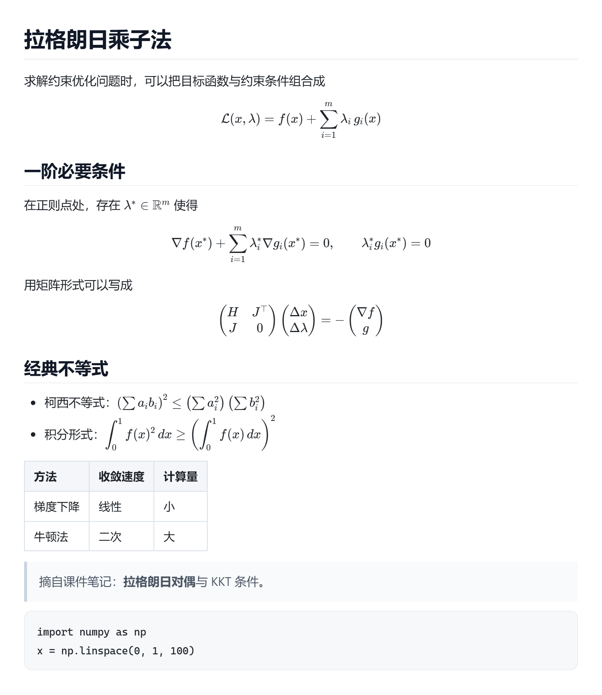

# txt → LaTeX + Markdown 图片

上传一个 txt（或 md / tex）文件，按 **KaTeX（LaTeX） + Markdown** 渲染，导出成任意尺寸的 PNG 图片。

纯前端、完全离线：双击 `start.bat` 用 Edge / Chrome 打开即可，不需要装依赖、不需要联网、不需要起服务器。



## 怎么用

1. 双击 `start.bat`（或直接打开 `index.html`）。
2. 点击选择文件 / 把 txt 拖进虚线框，也可以直接在左侧文本框里粘贴、修改。
3. 在「图片尺寸」里调：宽度、内边距、正文字号、清晰度（1×/2×/3×）、背景色、文件名。
4. 右侧实时预览，点「下载图片」得到 PNG；`Ctrl + S` 也可以直接下载。

## 支持的写法

- Markdown：标题、列表、表格、引用、代码块、粗斜体、链接、分隔线（marked 渲染）
- 行内公式：`$...$`、`\(...\)`
- 块级公式：`$$...$$`、`\[...\]`
- LaTeX 环境：`equation`、`align`、`gather`、`multline`、`split`、`cases`、矩阵等
- 代码块（``` 或 ~~~）里的 `$` 不会被当成公式
- `\$` 会原样输出为美元符号
- 图片：``，导出前会自动转成内联 data URI 一起画进 PNG

## 图片注意事项（重要）

导出使用 SVG `foreignObject`，浏览器在那里**不会加载外部图片**，所以下载前必须把图片内联。工具会自动用 `fetch` 把 `src` 转成 base64，规则如下：

| 打开方式 | 本地相对路径图片（如 ``） | 网络图片 |
| --- | --- | --- |
| 双击 `index.html`（file://） | **无法读取**，导出会缺图 | 需要对方允许 CORS |
| `serve.bat`（本地 http） | 正常 | 需要对方允许 CORS |
| 图片本身就是 data URI | 正常 | — |

所以：**txt 里带本地图片时，请用 `serve.bat` 打开**（需要本机有 Python，双击后自动起 `http://127.0.0.1:8765` 并打开浏览器）。哪张图片没嵌进去，下载后状态栏会明确列出来。若浏览器提示缺图且无法解决，把图片改成 data URI（或贴图 BASE64）即可。

## 自定义大小

| 参数 | 作用 | 范围 |
| --- | --- | --- |
| 图片宽度 | 最终 PNG 的宽度（CSS 像素），公式会按这个宽度居中排版 | 200 – 4000 |
| 内边距 | 内容到图片边缘的留白 | 0 – 200 |
| 正文字号 | 正文与公式的基础字号，公式随正文缩放 | 8 – 64 |
| 清晰度 | 导出倍率，2× 表示 800 宽会输出 1600 px，适合贴到文档/PPT | 1× / 2× / 3× |

最终尺寸会实时显示在预览右上角，例如 `800 × 923 px · 导出 1600 × 1846 px`。

## 原理（方便二次修改）

- `vendor/marked/marked.min.js` 把 Markdown 渲染成 HTML；
- 公式先用占位符从源码里抠出来，逐段用 `katex.renderToString` 渲染，再回填进 HTML，避免 Markdown 把 `_`、`*` 之类吃掉；
- 导出时把内容节点序列化成 XHTML 塞进 `<foreignObject>`，连同**已内联为 base64 的 KaTeX 字体**一起做成 SVG，再用 `canvas.drawImage` 光栅化成 PNG（所以字体不会丢、结果和预览一致）。

## 文件结构

```
index.html                        页面
app.css                           界面样式
app.js                            解析、预览、导出逻辑
start.bat                         直接以 file:// 打开（内容不含本地图片时够用）
serve.bat                         用本地 http 打开（要嵌入本地图片时用）
vendor/katex/katex.min.js         KaTeX
vendor/katex/katex.embedded.js    内联了字体的 KaTeX 样式（由下面脚本生成）
vendor/marked/marked.min.js       marked
tools/generate_katex_css.py       重新生成 katex.embedded.js
example.txt / example.md          示例输入
screenshot.png                    导出效果示例
```

升级 KaTeX 字体后，运行一次即可重新内联：

```
python tools\generate_katex_css.py
```

## 已知限制

- 图片里的公式如果比「图片宽度」还宽，会被裁切——页面会提示，请把宽度调大。
- 导出依赖 SVG `foreignObject`，请用 Edge / Chrome 打开；Firefox 也能用，Safari 可能失败。
- 单张 PNG 最长边上限 32000 px（浏览器 canvas 限制）。
- 图片必须能内联（data URI 或可 fetch 的地址），见上面的「图片注意事项」。
